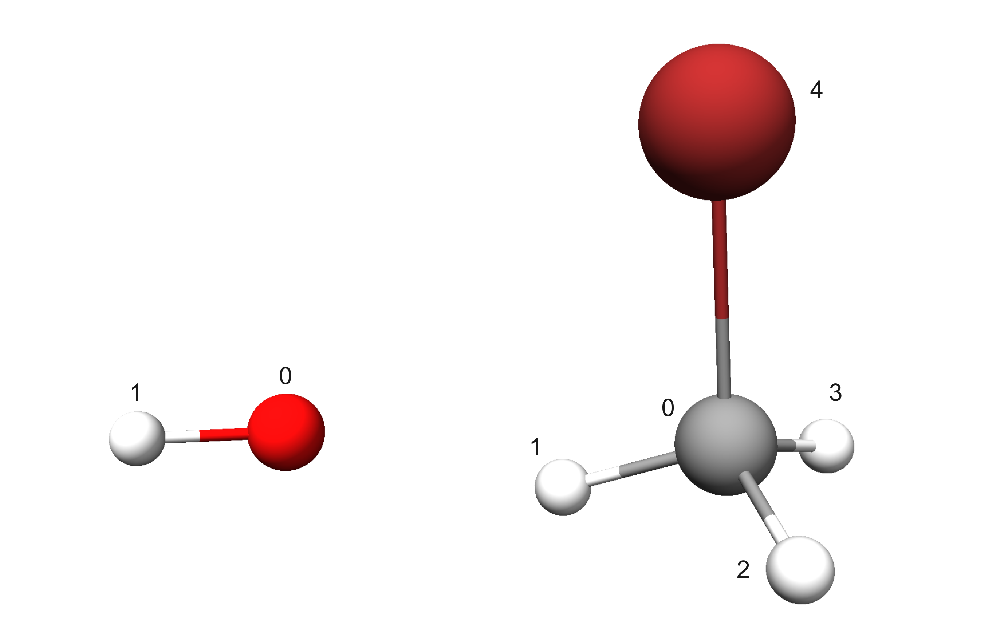
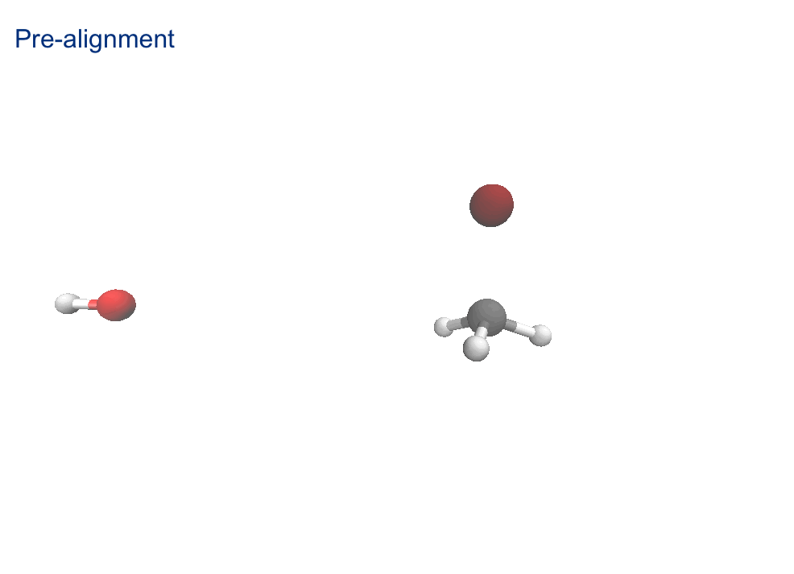
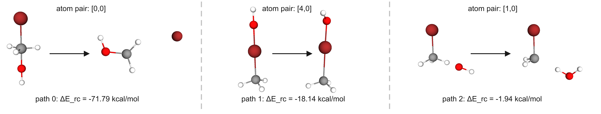
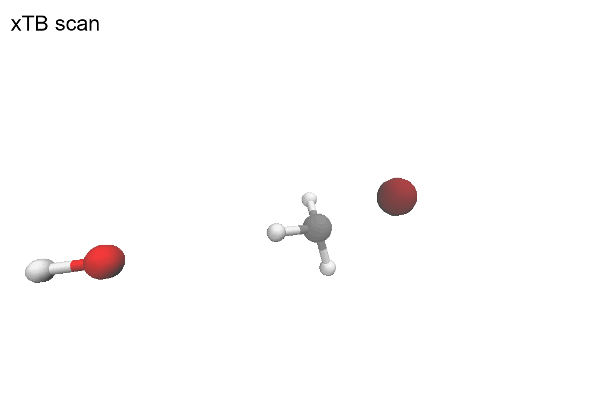
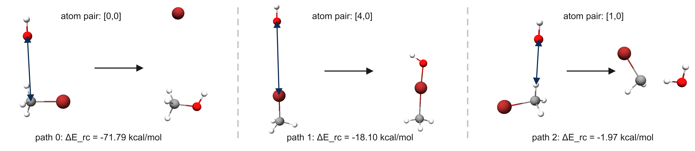
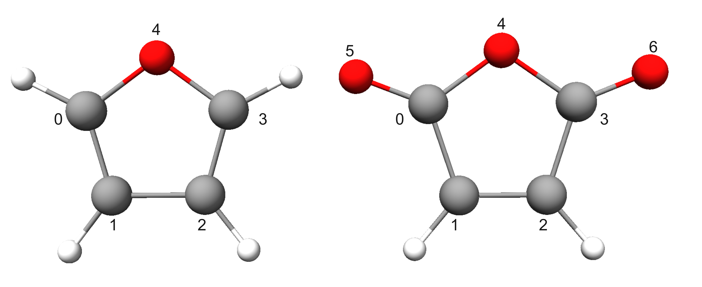
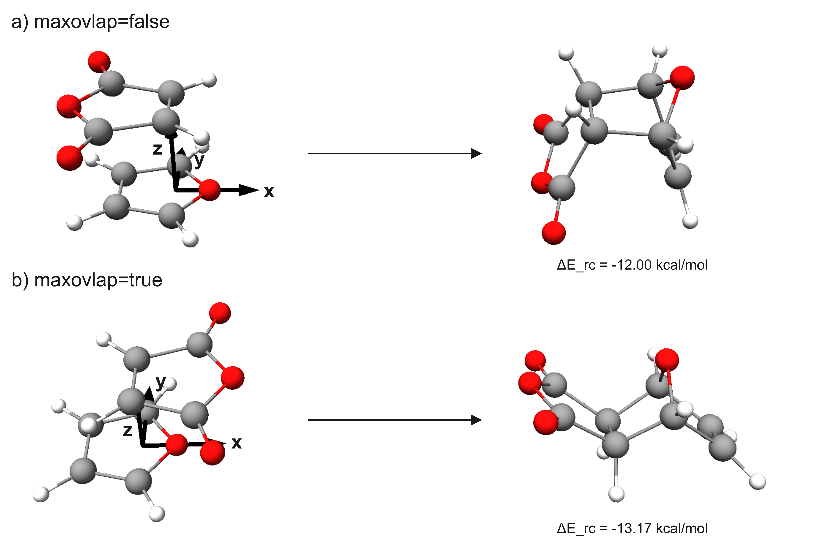

# Intermolecular Reaction Search
Search for intermolecular reactions using the given reactant structures with *aRST version 2.2.0*.

**Contents**

[TOC]

---
## Standard step search
In the following, standard runs are demonstrated using the $\mathrm{OH^- + CH_3Br \rightarrow CH_3OH + Br^-}$ as an example.

{width="60%" .center-img}
<span class="caption-center">Input structures of $\mathrm{OH^-}$ and $\mathrm{CH_3Br}$.</span>

=== "command"

    ```
    aRST input.toml --explore
    ```
    This command must be executed from the command line. 
    You can save the terminal output by appending `> record.log 2>&1` to the end of the command. 
    The resulting log file will look similar to the example shown in the `output` tab above. 
    In addition, the file `struc.json` records detailed electronic information for all structures encountered during the search, while file `reaction.json` records detailed reaction information.

=== "input.toml (FF algorithm)"

    ```toml
    [geom.reactant1]
    name="coord1.xyz"
    charge=-1 
    multiplicity=1
    
    [geom.reactant2]
    name="coord2.xyz"
    charge=0
    multiplicity=1

    [read.general]
    gfn2opt=true
    
    [searching_setting.general]
    sp_method="gxtb"
    scan_mode=1  
    
    [searching_setting.reactivity]
    afo_method="gfn2"
    
    [searching_setting.inter]
    number="all" # search all atom pairs; alternatively, specify an integer to define the search range

    [xtb_setting]
    method="gfn2"
    alpb="h2o"
    scan_etemp=1000
    k=1
    ```

=== "input.toml (scanning algorithm)"

    ```toml
    [geom.reactant1]
    name="coord1.xyz"
    charge=-1 
    multiplicity=1
    
    [geom.reactant2]
    name="coord2.xyz"
    charge=0
    multiplicity=1

    [read.general]
    gfn2opt=true
    
    [searching_setting.general]
    sp_method="gxtb"
    scan_mode=0
    
    [searching_setting.reactivity]
    afo_method="gfn2"
    
    [searching_setting.inter]
    number="all" # search all atom pairs; alternatively, specify an integer to define the search range

    [xtb_setting]
    method="gfn2"
    alpb="h2o"
    scan_etemp=1000
    k=1
    step=20
    ```

=== "coord1.xyz"
    ```
    2
    energy: -4.681670191098 gnorm: 0.000072593842 xtb: 6.7.0 (75e6a61)
    O           -1.10364287554518       -0.36139057189203        0.00000000000000
    H           -0.12589615445482       -0.31775564810797        0.00000000000000
    ```
=== "coord2.xyz"
    ```
    5
    energy: -7.745509058874 gnorm: 0.000124445434 xtb: 6.7.0 (75e6a61)
    C            6.08685650134955       -0.92164218186541        1.97795057511589
    H            5.90805783277699       -1.93687730870599        1.63950290669753
    H            6.73386941185747       -0.91368357018960        2.84888577643496
    H            6.50621187116026       -0.31734788078441        1.18033706387577
    Br           4.38455438285574       -0.14875905845460        2.48644367787585
    ```

=== "output (FF)"

    ```
     ==========================================================================================
     |                                                                                        |
     |                                                                                        |
     |                      automated Reaction Search Tool (aRST) V2.2.0                      |
     |                                                                                        |
     |                                                                                        |
     ==========================================================================================
     # Author:             Y. Chen, C. Bannwarth
     # Institute:          Institute of Physical Chemistry
     #                     RWTH Aachen University
     # Version date:       03.2026
     # Job running at:     26-02-2026 22:21:53
     ==========================================================================================

    Checking input TOML...done.
    
    Checking envirment...done.
    
    Refining structure information of input [0, 1] ...
    done.

                  ┌──────────────────────────────────────────────────────────────┐
                  │                     Theory Level Setting                     │
                  ├──────────────────────────────────────────────────────────────┤
                  ├──────────────────────────────────────────────────────────────┤
                  │                    Geometry Optimization                     │
                  ├──────────────────────────────────────────────────────────────┤
                  │ Method            : gfn2                                     │
                  │ Opt Level         : normal                                   │
                  │ Solvation         : ALPB(h2o)                                │
                  │ Etemp             : 300 K                                    │
                  │ Re-opt input      : gfn2                                     │
                  ├──────────────────────────────────────────────────────────────┤
                  │                     Reactivity Features                      │
                  ├──────────────────────────────────────────────────────────────┤
                  │ Method            : gfn2                                     │
                  │ Solvation         : ALPB(h2o)                                │
                  │ AFO Gap tolerance : 0.01 eV                                  │
                  ├──────────────────────────────────────────────────────────────┤
                  │                     Reaction Simulation                      │
                  ├──────────────────────────────────────────────────────────────┤
                  │ Method            : harmonic FF                              │
                  │ Etemp             : 1000 K                                   │
                  ├──────────────────────────────────────────────────────────────┤
                  │                     Single-Point Energy                      │
                  ├──────────────────────────────────────────────────────────────┤
                  │ Method            : gxtb                                     │
                  └──────────────────────────────────────────────────────────────┘

    Start doing reaction exploartions with given structues:  [0, 1]
    begin cycle 0:


                                    ***************************                                     
                                    * Bimolecular Association *                                     
                                    ***************************                                     

          --------------------------------------------------------------------------------
                                       Reactivity Assessment                                        
          Reactants: [0, 1], tot.atom pairs: 6
          Top 10 reactivity predictions:
          --------------------------------------------------------------------------------
           Ranking    Struc combi               Atom pair                 AFO gap    
          --------------------------------------------------------------------------------
              0         [1, 0]                    [0,0]                    -0.46     
              1         [1, 0]                    [4,0]                    -0.36     
              2         [1, 0]                    [1,0]                    0.96      
              3         [1, 0]                    [0,1]                    15.85     
              4         [1, 0]                    [4,1]                    15.95     
              5         [1, 0]                    [1,1]                    17.27     
          --------------------------------------------------------------------------------
          The full AFO gap list is written to the file react_l.

    Paths for Ranking 0-9 will be simulated: 
    Simulating interA path 0_0: R=[0, 1], atl=[[0, 0]], uhf_sim=0 ...done.
    Simulating interA path 0_1: R=[0, 1], atl=[[4, 0]], uhf_sim=0 ...done.
    Simulating interA path 0_2: R=[0, 1], atl=[[1, 0]], uhf_sim=0 ...done.
    Simulating interA path 0_3: R=[0, 1], atl=[[0, 1]], uhf_sim=0 ...done.
    Simulating interA path 0_4: R=[0, 1], atl=[[4, 1]], uhf_sim=0 ...done.
    Simulating interA path 0_5: R=[0, 1], atl=[[1, 1]], uhf_sim=0 ...done.

                                 *********************************                                  
                                 * Exploration Summary of Node 0 *                                  
                                 *********************************                                  

     ------------------------------------------------------------------------------------------
       #   RXNID   Scan_wd      R       Atom Pair       P     ΔE (kcal/mol)         Note
     ------------------------------------------------------------------------------------------
       0     1       0_0      [1, 0]     [[0, 0]]     [2, 3]      -71.79     New RXN
       1     2       0_1      [1, 0]     [[4, 0]]      [4]        -18.14     New RXN
       2     3       0_2      [1, 0]     [[1, 0]]     [5, 6]      -1.94      New RXN
       3     4       0_3      [1, 0]     [[0, 1]]     [2, 3]      -71.79     RXN same to 1
       4     -       0_4      [1, 0]     [[4, 1]]     [1, 0]       0.00      R=P
       5     -       0_5      [1, 0]     [[1, 1]]     [1, 0]       0.00      R=P
     ------------------------------------------------------------------------------------------

    ***** Job finished in 0 hour 0 mins 4.52 sec *****

    ```
    After running, each indexed reaction will be written to the `reaction.json` file, and each indexed structure will be written to the `struc.json` file.
=== "output (scan)"

    ```
     ==========================================================================================
     |                                                                                        |
     |                                                                                        |
     |                      automated Reaction Search Tool (aRST) V2.2.0                      |
     |                                                                                        |
     |                                                                                        |
     ==========================================================================================
     # Author:             Y. Chen, C. Bannwarth
     # Institute:          Institute of Physical Chemistry
     #                     RWTH Aachen University
     # Version date:       03.2026
     # Job running at:     26-02-2026 16:48:05
     ==========================================================================================

    Checking input TOML...done.
    
    Checking envirment...done.
    
    Refining structure information of input [0, 1] ...
    done.

                  ┌──────────────────────────────────────────────────────────────┐
                  │                     Theory Level Setting                     │
                  ├──────────────────────────────────────────────────────────────┤
                  ├──────────────────────────────────────────────────────────────┤
                  │                    Geometry Optimization                     │
                  ├──────────────────────────────────────────────────────────────┤
                  │ Method            : gfn2                                     │
                  │ Opt Level         : -                                        │
                  │ Solvation         : ALPB(h2o)                                │
                  │ Etemp             : 300 K                                    │
                  │ Re-opt input      : gfn2                                     │
                  ├──────────────────────────────────────────────────────────────┤
                  │                     Reactivity Features                      │
                  ├──────────────────────────────────────────────────────────────┤
                  │ Method            : gfn2                                     │
                  │ Solvation         : ALPB(h2o)                                │
                  │ Gap tolerance     : 0.01 eV                                  │
                  ├──────────────────────────────────────────────────────────────┤
                  │                     Reaction Simulation                      │
                  ├──────────────────────────────────────────────────────────────┤
                  │ Method            : xTB scan                                 │
                  │ Etemp             : 1000 K                                   │
                  ├──────────────────────────────────────────────────────────────┤
                  │                     Single-Point Energy                      │
                  ├──────────────────────────────────────────────────────────────┤
                  │ Method            : gxtb                                     │
                  └──────────────────────────────────────────────────────────────┘

    Start doing reaction exploartions with given structues:  [0, 1]
    begin cycle 0:


                                    ***************************                                     
                                    * Bimolecular Association *                                     
                                    ***************************                                     

          --------------------------------------------------------------------------------
                                       Reactivity Assessment                                        
          Reactants: [0, 1], tot.atom pairs: 6
          Top 10 reactivity predictions:
          --------------------------------------------------------------------------------
           Ranking    Struc combi               Atom pair                 AFO gap    
          --------------------------------------------------------------------------------
              0         [1, 0]                    [0,0]                    -0.46     
              1         [1, 0]                    [4,0]                    -0.36     
              2         [1, 0]                    [1,0]                    0.96      
              3         [1, 0]                    [0,1]                    15.85     
              4         [1, 0]                    [4,1]                    15.95     
              5         [1, 0]                    [1,1]                    17.27     
          --------------------------------------------------------------------------------
          The full AFO gap list is written to the file react_l.

    Paths for Ranking 0-9 will be simulated: 
    Simulating interA path 0_0: R=[0, 1], atl=[[0, 0]], uhf_sim=0 ...done.
    Simulating interA path 0_1: R=[0, 1], atl=[[4, 0]], uhf_sim=0 ...done.
    Simulating interA path 0_2: R=[0, 1], atl=[[1, 0]], uhf_sim=0 ...done.
    Simulating interA path 0_3: R=[0, 1], atl=[[0, 1]], uhf_sim=0 ...done.
    Simulating interA path 0_4: R=[0, 1], atl=[[4, 1]], uhf_sim=0 ...done.
    Simulating interA path 0_5: R=[0, 1], atl=[[1, 1]], uhf_sim=0 ...done.

                                 *********************************                                  
                                 * Exploration Summary of Node 0 *                                  
                                 *********************************                                  

     ------------------------------------------------------------------------------------------
       #   RXNID   Scan_wd      R       Atom Pair       P     ΔE (kcal/mol)         Note       
     ------------------------------------------------------------------------------------------
       0     1       0_0      [1, 0]     [[0, 0]]     [2, 3]      -71.79     New RXN                
       1     2       0_1      [1, 0]     [[4, 0]]      [4]        -18.10     New RXN                
       2     3       0_2      [1, 0]     [[1, 0]]     [5, 6]      -1.97      New RXN                
       3     4       0_3      [1, 0]     [[0, 1]]     [2, 3]      -71.78     RXN same to 1          
       4     -       0_4      [1, 0]     [[4, 1]]     [1, 0]       0.00      R=P                    
       5     -       0_5      [1, 0]     [[1, 1]]     [1, 0]       0.00      R=P                    
     ------------------------------------------------------------------------------------------

    ***** Job finished in 0 hour 0 mins 8.73 sec *****
    ```
    After running, each indexed reaction will be written to the `reaction.json` file, and each indexed structure will be written to the `struc.json` file.


The execution of this command allows the intermolecular reactivity of atom pairs to be ranked according to their AFO gaps. The sorted ranking list will look something like the following table and will be written as JSON entries to the file `react_l`.

<div class="caption-left">
AFO gaps at the GFN2-xTB+ALPB(H2O) level
</div>

| Ranking | Structure index | Atom pair combination | AFO gap (eV) | Can form coorespongding stable product? |
|---------|-----------------|-----------------------|--------------|-----------------------------------------|
| 0       | [1,0]           | [0, 0]                | -0.46        | ✔                                       |
| 1       | [1,0]           | [4, 0]                | -0.36        | ✔                                       |
| 2       | [1,0]           | [1, 0]                | 0.96         | ✔                                       |
| 3       | [1,0]           | [0, 1]                | 15.85        | ✖                                       |
| 4       | [1,0]           | [4, 1]                | 15.95        | ✖                                       |
| 5       | [1,0]           | [1, 1]                | 17.27        | ✖                                       |

!!! note
    Not all atom pairs with low AFO gaps necessarily have chemical relevance for the formation of new bonds.
    To review the AFO ranking for a given structure, users can execute `[OPTION]=afo_feature` and, if necessary, adjust the search range or exclude specific atom pair combinations. Example runs with exclusions are provided in [Example with exclusion](#search-with-exclusion-or-specific-atom-pair-selection) and [Concerted example](#concerted-step-search)


In this example, top three most reactive atom-pair can lead to low-energy products. See the output files shown in the tabs above.

To generate the product structures corresponding to each atom-pair reaction prediction, two algorithms have been implemented:
#### Option 1: Using harmonic FF algorithm `scan_mode = 1`

When exploring each reaction pathway using the FF algorithm, the selected atom pair is forced to combine in the product topology, followed by a fully relaxed geometry optimization. For example, for **path 0**, this process is shown in the GIF below.

{width="70%" .center-img}
<span class="caption-center">Reaction path 0 simulation using harmonic FF.</span>

All modeled reaction paths using harmonic FF schema that lead to low-energy products are shown below.

{width="98%" .center-img}
<span class="caption-center">The three lowest-energy ($\Delta E_\mathrm{rc} = \sum_i E_{i,\mathrm{product}} - \sum_j E_{j,\mathrm{reactant}}$) product structures generated by *aRST* using harmonic FF algorithm.<br>Left: FF-idealized structure; right: relaxed structure, with electronic reaction energy obtained at gxtb//GFN2-xTB+ALPB(H2O) level.</span>


---

#### Option 2: Using scanning algorithm

When exploring each reaction pathway using the scanning algorithm, the program automatically performs a relaxed potential energy surface (PES) scan along the interatomic distance coordinate of the reactive atom pair. For **path 0**, this process is shown in the GIF below.


{width="70%" .center-img}
<span class="caption-center">Reaction path 0 simulation using xTB scan.</span>

All modeled reaction paths using xTB scanning schema that lead to low-energy products are shown below.

{width="98%" .center-img}
<span class="caption-center">The three lowest-energy product structures generated by *aRST* using the scanning algorithm.<br>Left: pre-aligned structure, the blue arrow denotes the scan coordinate; right: relaxed structure, with electronic reaction energy obtained at gxtb//GFN2-xTB+ALPB(H2O) level.</span>

---

## Search with exclusion or specific atom-pair selection
Users may prescreen the AFO gap ranking list by defining prescreening rules. The rules implemented in *aRST* allow exclusion of specific element–element combinations or atom pairs involving designated elements. The following input files show the use of exclusions based on the SN2 reaction example introduced above.

=== "input.toml (excluding H–Br combinations)"

    ```toml
    [geom.reactant1]
    name="coord1.xyz"
    charge=-1 
    multiplicity=1
    
    [geom.reactant2]
    name="coord2.xyz"
    charge=0
    multiplicity=1

    [read.general]
    gfn2opt=true
    
    [searching_setting.general]
    sp_method="gxtb"
    scan_mode=1  
    
    [searching_setting.reactivity]
    afo_method="gfn2"
    
    [searching_setting.inter]
    number="all"
    exclude_pairs=[[1,35]]

    [xtb_setting]
    method="gfn2"
    alpb="h2o"
    scan_etemp=1000
    k=1
    ```

=== "input.toml (excluding H and Br-involved atom pairs)"

    ```toml
    [geom.reactant1]
    name="coord1.xyz"
    charge=-1 
    multiplicity=1
    
    [geom.reactant2]
    name="coord2.xyz"
    charge=0
    multiplicity=1

    [read.general]
    gfn2opt=true
    
    [searching_setting.general]
    sp_method="gxtb"
    scan_mode=1 
    exclude_elements=[1,35]
    
    [searching_setting.reactivity]
    afo_method="gfn2"
    
    [searching_setting.inter]
    number="all"

    [xtb_setting]
    method="gfn2"
    alpb="h2o"
    scan_etemp=1000
    k=1
    ```
=== "input.toml (specifing perticular atom-pair combination)"

    ```toml
    [geom.reactant1]
    name="coord1.xyz"
    charge=-1 
    multiplicity=1
    
    [geom.reactant2]
    name="coord2.xyz"
    charge=0
    multiplicity=1

    [read.general]
    gfn2opt=true
    
    [searching_setting.general]
    sp_method="gxtb"
    scan_mode=1  
    
    [searching_setting.reactivity]
    afo_method="gfn2"
    
    [searching_setting.inter]
    number=1
    atom_pair=[[0,0]]

    [xtb_setting]
    method="gfn2"
    alpb="h2o"
    scan_etemp=1000
    k=1
    ```

The resulting atom-pair comnination lists are compared below.

<div class="caption-left">
Comparison of atom-pair combinations with and without exclusion rules. Atom pairs are denoted as [at of struc1, at of struc2]
</div>

| Ranking | Without exclusion | Excluding H–Br combinations | Excluding H and Br-involved atom pairs | specifing perticular atom pair |
|---------|-------------------|-----------------------------|----------------------------------------|--------------------------------|
| 0       | [0, 0]            | [0, 0]                      | [0, 0]                                 | [0, 0]                         |
| 1       | [4, 0]            | [4, 0]                      | —                                      | —                              |
| 2       | [1, 0]            | [1, 0]                      | —                                      | —                              |
| 3       | [0, 1]            | [0, 1]                      | —                                      | —                              |
| 4       | [4, 1]            | [1, 1]                      | —                                      | —                              |
| 5       | [1, 1]            | —                           | —                                      | —                              |

The program then searches the existing list of atom pairs for the specified `number` of reaction pathways.
Hence, if the reaction center is known in advance or certain atom pairs are irrelevant, applying exclusion filters can significantly reduce the number of trial reaction pathways that need to be explored.

## Concerted step search

*aRST* supports the exploration of concerted reactions that involve multiple reactive centers in a single step, such as ring-addition reactions. In the following, a run is demonstrated for a Diels–Alder reaction taken from the GMTKN55 DARC subset.

{width="70%" .center-img}
<span class="caption-center">Input structures. Left: `coord1.xyz`; right: `coord2.xyz`.</span>

=== "input.toml (FF algorithm)"
    ```toml

    [geom.reactant1]
    name="coord1.xyz"
    charge=0
    multiplicity=1
    
    [geom.reactant2]
    name="coord2.xyz"
    charge=0
    multiplicity=1
    
    [read.general]
    gfn2opt=true
    
    [searching_setting.general]
    sp_method="gxtb"
    scan_mode=1
    exclude_elements=[1,8] # optional!
    
    [searching_setting.reactivity]
    afo_method="gfn2"
    
    [searching_setting.inter]
    number="all"
    concerted_pair=true
    maxovlap=false # default alignment style
    # maxovlap=true # altenative alignment style
    
    [xtb_setting]
    method="gfn2"
    alpb="h2o"
    scan_etemp=1000
    ```
=== "coord1.xyz"
    ```

    9
    
     C       1.085973230000       0.000000000000       0.568509750000
     C       0.713683990000       0.000000000000      -0.732249090000
     C      -0.713683990000       0.000000000000      -0.732249090000
     C      -1.085973230000       0.000000000000       0.568509750000
     O       0.000000000000       0.000000000000       1.372587790000
     H       2.042089730000       0.000000000000       1.064800680000
     H       1.370301140000       0.000000000000      -1.587355230000
     H      -1.370301140000       0.000000000000      -1.587355230000
     H      -2.042089730000       0.000000000000       1.064800680000
    ```

=== "coord2.xyz"
    ```

    9
    
     C       1.120826480000       0.000000000000       0.624330530000
     C       0.663439640000       0.000000000000      -0.786685470000
     C      -0.663439640000       0.000000000000      -0.786685470000
     C      -1.120826480000       0.000000000000       0.624330530000
     O       0.000000000000       0.000000000000       1.427413810000
     O       2.223123580000       0.000000000000       1.063656010000
     O      -2.223123580000       0.000000000000       1.063656010000
     H       1.356271560000       0.000000000000      -1.615007980000
     H      -1.356271560000       0.000000000000      -1.615007980000
    ```

=== "output"

    ```
     ==========================================================================================
     |                                                                                        |
     |                                                                                        |
     |                      automated Reaction Search Tool (aRST) V2.2.0                      |
     |                                                                                        |
     |                                                                                        |
     ==========================================================================================
     # Author:             Y. Chen, C. Bannwarth
     # Institute:          Institute of Physical Chemistry
     #                     RWTH Aachen University
     # Version date:       03.2026
     # Job running at:     26-02-2026 22:47:56
     ==========================================================================================

    Checking input TOML...done.

    Checking envirment...done.

    Reading structure information of input [0, 1] from folder struc/ ...
    done.

                  ┌──────────────────────────────────────────────────────────────┐
                  │                     Theory Level Setting                     │
                  ├──────────────────────────────────────────────────────────────┤
                  ├──────────────────────────────────────────────────────────────┤
                  │                    Geometry Optimization                     │
                  ├──────────────────────────────────────────────────────────────┤
                  │ Method            : gfn2                                     │
                  │ Opt Level         : normal                                   │
                  │ Solvation         : ALPB(h2o)                                │
                  │ Etemp             : 300 K                                    │
                  │ Re-opt input      : False                                    │
                  ├──────────────────────────────────────────────────────────────┤
                  │                     Reactivity Features                      │
                  ├──────────────────────────────────────────────────────────────┤
                  │ Method            : gfn2                                     │
                  │ Solvation         : ALPB(h2o)                                │
                  │ AFO Gap tolerance : 0.01 eV                                  │
                  │ Exclude elements  : [1, 8]                                   │
                  ├──────────────────────────────────────────────────────────────┤
                  │                     Reaction Simulation                      │
                  ├──────────────────────────────────────────────────────────────┤
                  │ Method            : harmonic FF                              │
                  │ Etemp             : 1000 K                                   │
                  ├──────────────────────────────────────────────────────────────┤
                  │                     Single-Point Energy                      │
                  ├──────────────────────────────────────────────────────────────┤
                  │ Method            : gxtb                                     │
                  └──────────────────────────────────────────────────────────────┘

    Start doing reaction exploartions with given structues:  [0, 1]
    begin cycle 0:


                                    ***************************                                     
                                    * Bimolecular Association *                                     
                                    ***************************                                     

          --------------------------------------------------------------------------------
                                       Reactivity Assessment                                        
          Reactants: [0, 1], tot.atom pairs: 4
          Top 10 reactivity predictions:
          --------------------------------------------------------------------------------
           Ranking    Struc combi               Atom pair                 AFO gap    
          --------------------------------------------------------------------------------
              0         [1, 0]                [0,1], [3,2]                 2.66      
              1         [1, 0]                [1,1], [2,2]                 2.82      
              2         [1, 0]                [0,0], [3,3]                 2.84      
              3         [1, 0]                [1,0], [2,3]                 3.00      
          --------------------------------------------------------------------------------
          The full AFO gap list is written to the file react_l.

    Paths for Ranking 0-9 will be simulated: 
    Simulating interA path 0_0: R=[0, 1], atl=[[0, 1], [3, 2]], uhf_sim=0 ...done.
    Simulating interA path 0_1: R=[0, 1], atl=[[1, 1], [2, 2]], uhf_sim=0 ...done.
    Simulating interA path 0_2: R=[0, 1], atl=[[0, 0], [3, 3]], uhf_sim=0 ...done.
    Simulating interA path 0_3: R=[0, 1], atl=[[1, 0], [2, 3]], uhf_sim=0 ...done.

                                 *********************************                                  
                                 * Exploration Summary of Node 0 *                                  
                                 *********************************                                  

     ------------------------------------------------------------------------------------------
       #   RXNID   Scan_wd      R       Atom Pair       P     ΔE (kcal/mol)         Note       
     ------------------------------------------------------------------------------------------
       0     -       0_0      [1, 0]  [[0, 1], [3, 2]]  [1, 0]       0.00      R=P                    
       1     2       0_1      [1, 0]  [[1, 1], [2, 2]]   [2]        45.96      New RXN                
       2     -       0_2      [1, 0]  [[0, 0], [3, 3]]  [1, 0]       0.00      R=P                    
       3     4       0_3      [1, 0]  [[1, 0], [2, 3]]   [3]        -13.17     New RXN                
     ------------------------------------------------------------------------------------------

    ***** Job finished in 0 hour 0 mins 6.08 sec *****
    ```
    After running, each indexed reaction will be written to the `reaction.json` file, and each indexed structure will be written to the `struc.json` file.

In this example, we apply a filter that restricts the search to **C**-atom-related reaction pathways by specifying the key `exclude_elements=[1,8]`. As a result, the intermolecular reactivity of concerted atom pairs within the system can be ranked as follows, where the **path 3** corresponds to the reference product atomic connectivity:

<div class="caption-left">
AFO gaps at the GFN2-xTB+ALPB(H2O) level
</div>

| Ranking | Structure index | Atom pair combination | AFO gap (eV) |
|---------|-----------------|-----------------------|--------------|
| 0       | [1,0]           | [[0, 1], [3, 2]]      | 2.66         |
| 1       | [1,0]           | [[1, 1], [2, 2]]      | 2.82         |
| 2       | [1,0]           | [[0, 0], [3, 3]]      | 2.84         |
| **3**   | **[1,0]**       | **[[1, 0], [2, 3]]**  | **3.00**     |

For concerted reactions, the reactive center is defined as the midpoint between the two reactive atoms of each reactant structure.
Below, the two different alignment styles provided are shown for **path 3**.

{width="88%" .center-img}
<span class="caption-center">Two alignment schemes for **path 3**. Electronic reaction energy obtained at gxtb//GFN2-xTB+ALPB(H2O) level.</span>

Each alignment scheme  leads to a different stereoisomeric product. Both simulated structures match the reference product geometries.
