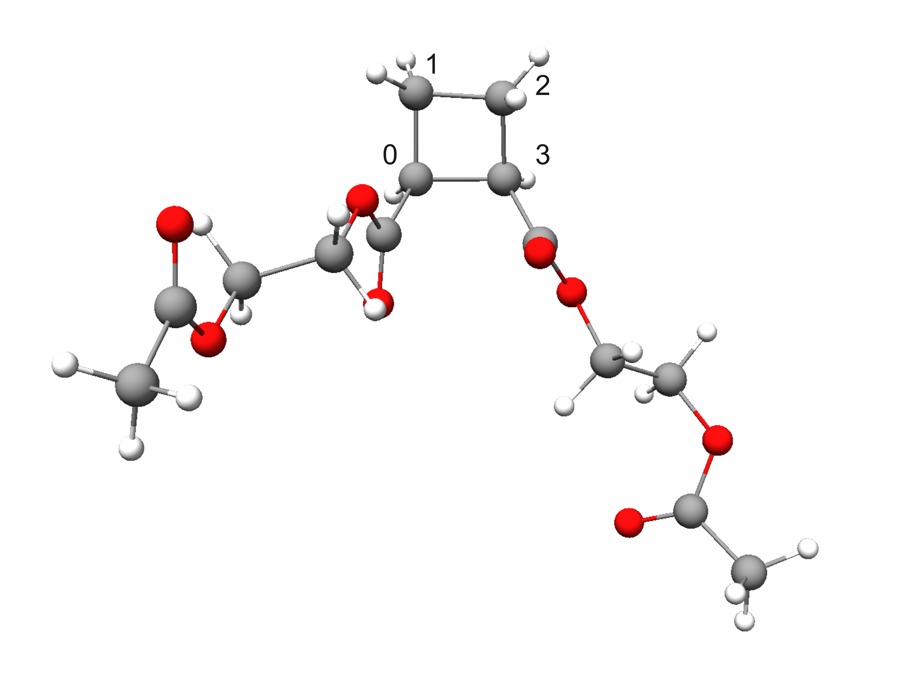
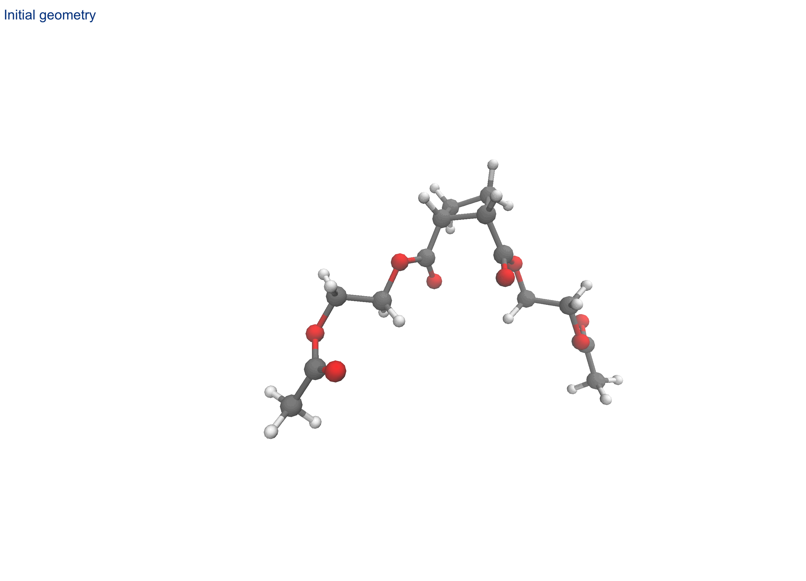
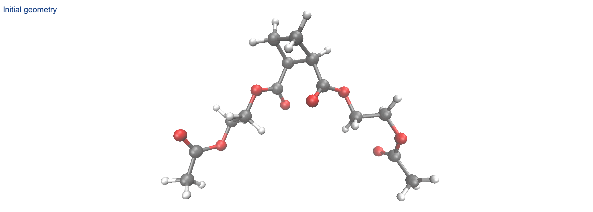

# Dissociation Search
Search for dissociation step using the given reactant structure with *aRST version 2.2.0*.

**Contents**

[TOC]

---
In the following, a run searching dissociation step is demonstrated using a dissociation of mechanophre obtained from Klein's paper as an example.

{width="80%" .center-img}
<span class="caption-center">Input structure where bond in which the bonds between 0–3 and 1–2 are expected to break under load. </span>

## Standard step search by pulling the target bond

=== "command"

    ```
    aRST input.toml --explore
    ```
    This command must be executed from the command line. 
    You can save the terminal output by appending `> record.log 2>&1` to the end of the command. 
    The resulting log file will look similar to the example shown in the `output` tab above. 
    In addition, the file `struc.json` records detailed electronic information for all structures encountered during the search, while file `reaction.json` records detailed reaction information.

=== "input.toml (FF algorithm)"
    
    ```toml
    [geom.reactant1]
    name="coord.xyz"
    charge=0
    multiplicity=1
    
    
    [read.general]
    gfn2opt=true
    
    [searching_setting.general]
    sp_method="gxtb"
    scan_mode=1
    
    [searching_setting.reactivity]
    afo_method="gfn2" # this also generate Mayer Bond Order at GFN2 lvl
    
    [searching_setting.disso]
    number=1
    pulling_distance=3 # if use FF schema, make sure not pulling too hard
    
    [xtb_setting]
    method="gfn2"
    alpb="h2o"
    scan_etemp=1000
    ```

=== "coord.xyz"

    ```
    42

    C            0.71336679055130        2.74927096042828        0.25390074951186
    C           -0.08590349577708        3.47942482607318        1.34744356983089
    C           -1.21148888854859        3.75554529200446        0.34003544420016
    C           -0.56947107456761        2.75915213806723       -0.63615926850370
    C           -1.16871524466250        1.37709498195290       -0.68715783114352
    C            1.21307350356688        1.37100240786473        0.58521635866779
    O            0.64627634766208        0.58165433482152        1.30985205133255
    O            2.35973892722611        1.11287021984146       -0.03400549681914
    C            2.94577707466685       -0.17727024740274        0.14374309949247
    C            4.46381243417022       -0.02997710630091        0.03402664523776
    O            5.11789686522682       -1.23207628482230        0.42790218715291
    C            5.14992402619172       -2.24857558757484       -0.44163049158589
    O            4.65780414866224       -2.18519129900658       -1.54678912755181
    C            5.85367389174617       -3.43562359684221        0.13296562848443
    O           -0.77542068090053        0.51618605039409       -1.44847658780233
    O           -2.12936983515539        1.18604602364258        0.20430210283700
    C           -2.68044021537309       -0.12109242286953        0.32447133567556
    C           -3.69376728127370       -0.40002750329269       -0.79142170435303
    O           -4.22615694453843       -1.71442791302004       -0.67400642268523
    C           -5.19454089664950       -1.92348437270486        0.22606471297665
    O           -5.63590778505413       -1.04582936389982        0.93444917958271
    C           -5.63783353460315       -3.35102033369573        0.23089873399198
    H            1.52445569680687        3.32584570902274       -0.18581875897585
    H           -0.38746573193068        2.79374774563299        2.13620017476910
    H            0.40513959147520        4.34655886962783        1.77734405202023
    H           -2.21491834815664        3.50388678804419        0.66733025094134
    H           -1.19209403975871        4.76922973167571       -0.04891248572598
    H           -0.39672389139331        3.09081086895999       -1.65931250554691
    H            2.66424517231215       -0.57075192061290        1.12673417551829
    H            2.56334502275746       -0.84602592135369       -0.63424968042684
    H            4.73602865561753        0.22084479312048       -0.99523788117206
    H            4.82015124273879        0.73626050879929        0.72296120607718
    H            6.40262455686041       -3.94910625073812       -0.65020399125930
    H            6.50976161037727       -3.12337748749388        0.93793361539194
    H            5.10419861010202       -4.11867505397812        0.52763512696609
    H           -1.87400721955706       -0.86086010029257        0.28813521295342
    H           -3.17263363187679       -0.13800440762539        1.29824893030460
    H           -4.50560457448527        0.33309305292276       -0.73932436196691
    H           -3.20310704103071       -0.36805287721278       -1.76555708943521
    H           -5.26557440131396       -3.85716210485092       -0.65277817223667
    H           -5.24079688229542       -3.83210058827756        1.12218682842673
    H           -6.72181252981880       -3.39343255902339        0.28208048484486

    ```

=== "output (FF)"

    ```    
     ==========================================================================================
     |                                                                                        |
     |                                                                                        |
     |                      automated Reaction Search Tool (aRST) V2.2.0                      |
     |                                                                                        |
     |                                                                                        |
     ==========================================================================================
     # Author:             Y. Chen, C. Bannwarth
     # Institute:          Institute of Physical Chemistry
     #                     RWTH Aachen University
     # Version date:       03.2026
     # Job running at:     27-02-2026 20:34:12
     ==========================================================================================
    
    Checking input TOML...done.
    
    Checking envirment...done.
    
    Refining structure information of input [0] ...
    done.

                  ┌──────────────────────────────────────────────────────────────┐
                  │                     Theory Level Setting                     │
                  ├──────────────────────────────────────────────────────────────┤
                  ├──────────────────────────────────────────────────────────────┤
                  │                    Geometry Optimization                     │
                  ├──────────────────────────────────────────────────────────────┤
                  │ Method            : gfn2                                     │
                  │ Opt Level         : normal                                   │
                  │ Solvation         : ALPB(h2o)                                │
                  │ Etemp             : 300 K                                    │
                  │ Re-opt input      : gfn2                                     │
                  ├──────────────────────────────────────────────────────────────┤
                  │                     Reactivity Features                      │
                  ├──────────────────────────────────────────────────────────────┤
                  │ Method            : gfn2                                     │
                  │ Solvation         : ALPB(h2o)                                │
                  │ AFO Gap tolerance : 0.01 eV                                  │
                  ├──────────────────────────────────────────────────────────────┤
                  │                     Reaction Simulation                      │
                  ├──────────────────────────────────────────────────────────────┤
                  │ Method            : harmonic FF                              │
                  │ Etemp             : 1000 K                                   │
                  ├──────────────────────────────────────────────────────────────┤
                  │                     Single-Point Energy                      │
                  ├──────────────────────────────────────────────────────────────┤
                  │ Method            : gxtb                                     │
                  └──────────────────────────────────────────────────────────────┘

    Start doing reaction exploartions with given structues:  [0]
    begin cycle 0:


                                          ****************                                          
                                          * Dissociation *                                          
                                          ****************                                          

          --------------------------------------------------------------------------------
                                       Reactivity Assessment                                        
          Reactants: [0], tot.atom pairs: 12
          Top 10 reactivity predictions:
          --------------------------------------------------------------------------------
           Ranking    Struc combi               Atom pair                   MBO      
          --------------------------------------------------------------------------------
              0            0                      [3,0]                    0.92      
              1            0                      [8,7]                    0.93      
              2            0                     [34,13]                   0.94      
              3            0                     [16,15]                   0.94      
              4            0                     [40,21]                   0.94      
              5            0                     [18,17]                   0.95      
              6            0                     [10,9]                    0.95      
              7            0                     [27,3]                    0.95      
              8            0                     [41,21]                   0.96      
              9            0                     [22,0]                    0.96      
          --------------------------------------------------------------------------------
          The full AFO gap list is written to the file react_l.

    Paths for Ranking 0-0 will be simulated: 
    Simulating disso path 0_0: R=[0], atl=[[3, 0]], uhf_sim=0 ...done.
    Simulating disso path 0_1: R=[0], atl=[[3, 0]], uhf_sim=2 ...done.

                                 *********************************                                  
                                 * Exploration Summary of Node 0 *                                  
                                 *********************************                                  

     ------------------------------------------------------------------------------------------
       #   RXNID   Scan_wd      R       Atom Pair       P     ΔE (kcal/mol)         Note       
     ------------------------------------------------------------------------------------------
       0     1       0_0       [0]       [[3, 0]]     [1, 1]      21.29      New RXN                
       1     2       0_1       [0]       [[3, 0]]     [1, 1]      21.23      RXN same to 1          
     ------------------------------------------------------------------------------------------

    ***** Job finished in 0 hour 0 mins 17.75 sec *****


    ```
    After running, each indexed reaction will be written to the `reaction.json` file, and each indexed structure will be written to the `struc.json` file.<br>
    If input geometry is closed-shell, for each seleted intramolecular atom pair, *aRST* simulates both the corresponding closed-shell and open-shell biradical products while generating product structure using `uhf=0` and `2` . Consequently, two trial reaction pathways are generated for each tested atom pair.

The execution of this command allows the intramolecular association reactivity of atom pairs to be ranked according to their Mayer bond order at the specified AFO feature level. The sorted ranking list will look something like the following table and will be written as JSON entries to the file `react_l`.

<div class="caption-left">
MBO at the GFN2-xTB+ALPB(H2O) level
</div>


| #   | Atom pair combination | MBO   |
|-----|-----------------------|-------|
| 0   | [3, 0]                | 0.920 |
| ... | ...                   | ...   |
| 31  | [2, 1]                | 1.004 |
| ... | ...                   | ...   |

In this example, the global weakest bond (**path 0**) corresponds to one of the bonds that dissociates under load according to experimental results.<br>
Using the harmonic force field (FF) reaction simulation scheme, aRST excludes this bond from the product topology. This leads to an idealized stretched geometry. After subsequent xTB optimization, the second target bond also dissociates.

The simulation process is demonstrated below.

{width="97%" .center-img}
<span class="caption-center">Reaction simulation of **path 0** by pulling Atom 0 and 3.</span>

## Step search by pulling arbitary atom pair

Alterniative, aRST allows stretching a molecule by pulling an arbitrary pair of atoms.


=== "input.toml (FF algorithm)"
    
    ```toml
    [geom.reactant1]
    name="coord.xyz"
    charge=0
    multiplicity=1
    
    
    [read.general]
    gfn2opt=true
    
    [searching_setting.general]
    sp_method="gxtb"
    scan_mode=1
    
    [searching_setting.reactivity]
    afo_method="gfn2" 
    
    [searching_setting.disso]
    number=1
    atom_pair=[[13,21]] # terminal atoms
    pulling_distance_add=10 # if use FF schema, make sure not pulling too hard
    
    [xtb_setting]
    method="gfn2"
    alpb="h2o"
    scan_etemp=1000
    k=5 # important: set this value to a sufficiently high number
    ```
=== "output (FF)"
    ```

         ==========================================================================================
         |                                                                                        |
         |                                                                                        |
         |                      automated Reaction Search Tool (aRST) V2.2.0                      |
         |                                                                                        |
         |                                                                                        |
         ==========================================================================================
         # Author:             Y. Chen, C. Bannwarth
         # Institute:          Institute of Physical Chemistry
         #                     RWTH Aachen University
         # Version date:       03.2026
         # Job running at:     27-02-2026 22:53:32
         ==========================================================================================

    Checking input TOML...done.
    
    Checking envirment:...done.
    
    Reading structure information of input [0] from folder struc/ ...
    done.

                  ┌──────────────────────────────────────────────────────────────┐
                  │                     Theory Level Setting                     │
                  ├──────────────────────────────────────────────────────────────┤
                  ├──────────────────────────────────────────────────────────────┤
                  │                    Geometry Optimization                     │
                  ├──────────────────────────────────────────────────────────────┤
                  │ Method            : gfn2                                     │
                  │ Opt Level         : normal                                   │
                  │ Solvation         : ALPB(h2o)                                │
                  │ Etemp             : 300 K                                    │
                  │ Re-opt input      : False                                    │
                  ├──────────────────────────────────────────────────────────────┤
                  │                     Reactivity Features                      │
                  ├──────────────────────────────────────────────────────────────┤
                  │ Method            : gfn2                                     │
                  │ Solvation         : ALPB(h2o)                                │
                  │ AFO Gap tolerance : 0.01 eV                                  │
                  ├──────────────────────────────────────────────────────────────┤
                  │                     Reaction Simulation                      │
                  ├──────────────────────────────────────────────────────────────┤
                  │ Method            : harmonic FF                              │
                  │ Etemp             : 1000 K                                   │
                  ├──────────────────────────────────────────────────────────────┤
                  │                     Single-Point Energy                      │
                  ├──────────────────────────────────────────────────────────────┤
                  │ Method            : gxtb                                     │
                  └──────────────────────────────────────────────────────────────┘

    Start doing reaction exploartions with given structues:  [0]
    begin cycle 0:


                                          ****************                                          
                                          * Dissociation *                                          
                                          ****************                                          

          --------------------------------------------------------------------------------
                                       Reactivity Assessment                                        
          Reactants: [0], tot.atom pairs: 42
          Top 10 reactivity predictions:
          --------------------------------------------------------------------------------
           Ranking    Struc combi               Atom pair                   MBO      
          --------------------------------------------------------------------------------
              0            0                      [3,0]                    0.92      
              1            0                      [8,7]                    0.93      
              2            0                     [34,13]                   0.94      
              3            0                     [16,15]                   0.94      
              4            0                     [40,21]                   0.94      
              5            0                     [18,17]                   0.95      
              6            0                     [10,9]                    0.95      
              7            0                     [27,3]                    0.95      
              8            0                     [41,21]                   0.96      
              9            0                     [22,0]                    0.96      
          --------------------------------------------------------------------------------
          The full AFO gap list is written to the file react_l.

    Paths for Ranking 0-0 will be simulated:
    Simulating disso path 0_0: R=[0], atl=[[13, 21]], uhf_sim=0 ...done.
    Simulating disso path 0_1: R=[0], atl=[[13, 21]], uhf_sim=2 ...done.

                                 *********************************                                  
                                 * Exploration Summary of Node 0 *                                  
                                 *********************************                                  

     ------------------------------------------------------------------------------------------
       #   RXNID   Scan_wd      R       Atom Pair       P     ΔE (kcal/mol)         Note       
     ------------------------------------------------------------------------------------------
       0     1       0_0       [0]      [[13, 21]]    [1, 1]      23.74      New RXN                
       1     2       0_1       [0]      [[13, 21]]   [2, 3, 3, 4, 4]     80.89      New RXN                
     ------------------------------------------------------------------------------------------

    ***** Job finished in 0 hour 0 mins 14.49 sec *****


    ```

In the given example, pulling the terminal atoms to an appropriate distance can also result in the dissociation of both target bonds.

{width="97%" .center-img}
<span class="caption-center">Reaction simulation of **path 0** by pulling terminal carbon atoms.</span>
