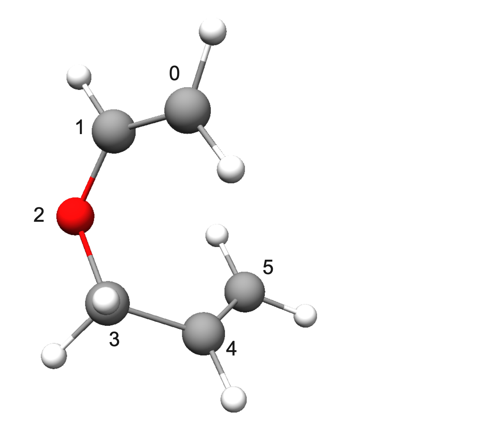
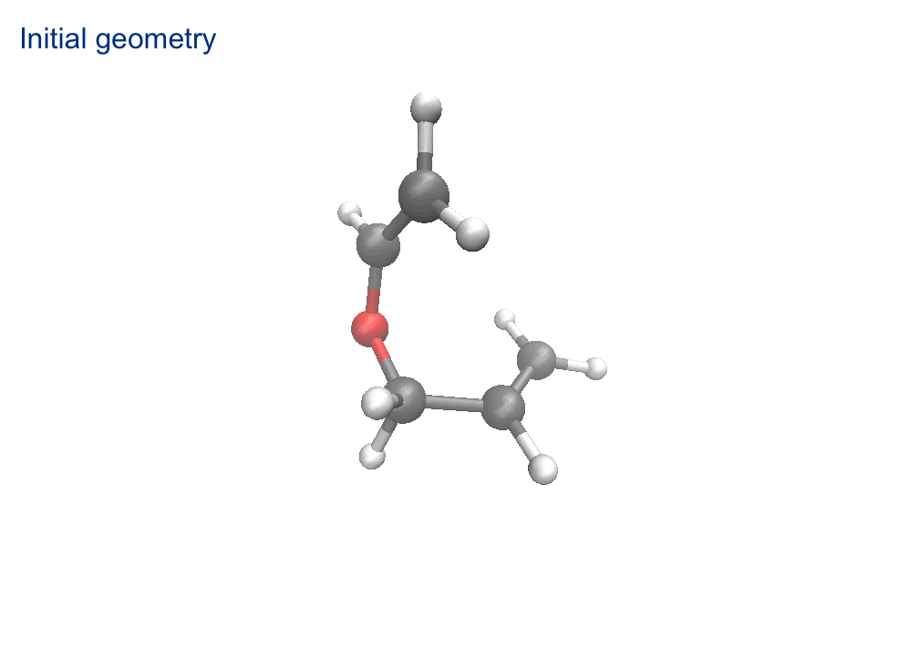
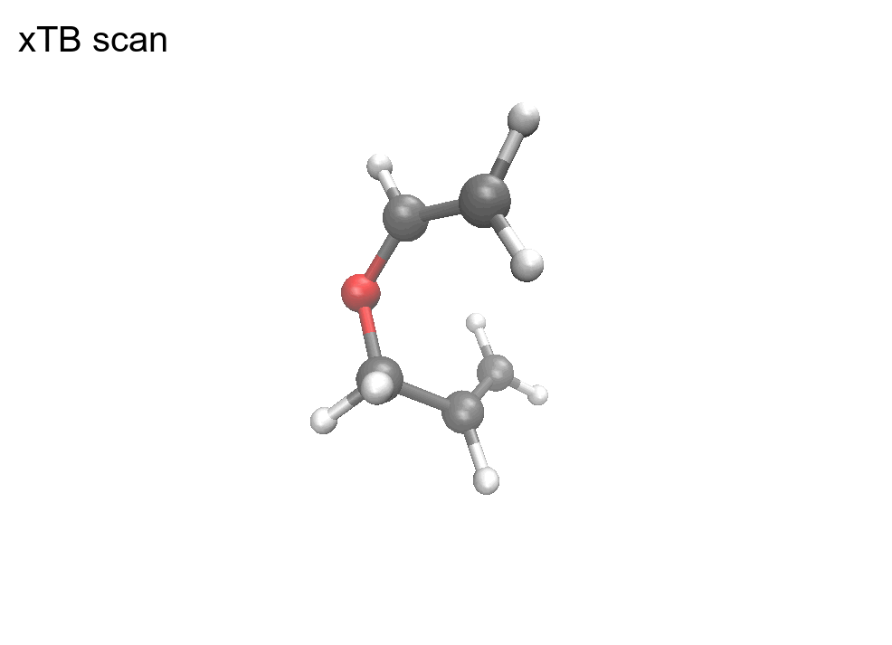

# Intramolecular Association Search
Search for intramolecular association using the given reactant structure with *aRST version 2.2.0*.

**Contents**

[TOC]

---
In the following, a run searching intramolecular association step is demonstrated using a typical Claisen rearrangement as an example.

{width="50%" .center-img}
<span class="caption-center">Input structure</span>

## Standard step search


=== "command"

    ```
    aRST input.toml --explore
    ```
    This command must be executed from the command line. 
    You can save the terminal output by appending `> record.log 2>&1` to the end of the command. 
    The resulting log file will look similar to the example shown in the `output` tab above. 
    In addition, the file `struc.json` records detailed electronic information for all structures encountered during the search, while file `reaction.json` records detailed reaction information.

=== "input.toml (FF algorithm)"
    
    ```toml
    [geom.reactant1]
    name="coord.xyz"
    charge=0
    multiplicity=1
    
    
    [read.general]
    gfn2opt=true
    
    [searching_setting.general]
    sp_method="gxtb"
    scan_mode=1
    exclude_elements=[1,8] # optional!
    
    [searching_setting.reactivity]
    afo_method="gfn2"
    
    [searching_setting.intra]
    number=3
    [xtb_setting]
    method="gfn2"
    alpb="h2o"
    scan_etemp=1000
    ```

=== "coord.xyz"

    ```
    14
      
    C          0.78722       -1.14188        6.21138
    C          1.99519       -1.74632        6.31069
    O          3.04395       -2.16456        5.52139
    C          3.33601       -2.14100        4.15081
    C          2.33271       -1.53943        3.25036
    C          1.18750       -1.01167        3.52837
    H          0.11702       -0.91291        7.03048
    H          0.19480       -0.75453        5.41550
    H          2.28213       -2.01012        7.32216
    H          4.32513       -2.64310        4.29108
    H          3.97547       -2.34317        3.23535
    H          2.55419       -1.51833        2.18447
    H          0.23057       -0.57040        3.75820
    H          0.84951       -0.72580        2.54110
    ```

=== "output (FF)"

    ```    
     ==========================================================================================
     |                                                                                        |
     |                                                                                        |
     |                      automated Reaction Search Tool (aRST) V2.2.0                      |
     |                                                                                        |
     |                                                                                        |
     ==========================================================================================
     # Author:             Y. Chen, C. Bannwarth
     # Institute:          Institute of Physical Chemistry
     #                     RWTH Aachen University
     # Version date:       03.2026
     # Job running at:     26-02-2026 23:03:17
     ==========================================================================================

    Checking input TOML...done.
    
    Checking envirment...done.
    
    Refining structure information of input [0] ...
    done.

                  ┌──────────────────────────────────────────────────────────────┐
                  │                     Theory Level Setting                     │
                  ├──────────────────────────────────────────────────────────────┤
                  ├──────────────────────────────────────────────────────────────┤
                  │                    Geometry Optimization                     │
                  ├──────────────────────────────────────────────────────────────┤
                  │ Method            : gfn2                                     │
                  │ Opt Level         : normal                                   │
                  │ Solvation         : ALPB(h2o)                                │
                  │ Etemp             : 300 K                                    │
                  │ Re-opt input      : gfn2                                     │
                  ├──────────────────────────────────────────────────────────────┤
                  │                     Reactivity Features                      │
                  ├──────────────────────────────────────────────────────────────┤
                  │ Method            : gfn2                                     │
                  │ Solvation         : ALPB(h2o)                                │
                  │ AFO Gap tolerance : 0.01 eV                                  │
                  │ Exclude elements  : [1, 8]                                   │
                  ├──────────────────────────────────────────────────────────────┤
                  │                     Reaction Simulation                      │
                  ├──────────────────────────────────────────────────────────────┤
                  │ Method            : harmonic FF                              │
                  │ Etemp             : 1000 K                                   │
                  ├──────────────────────────────────────────────────────────────┤
                  │                     Single-Point Energy                      │
                  ├──────────────────────────────────────────────────────────────┤
                  │ Method            : gxtb                                     │
                  └──────────────────────────────────────────────────────────────┘

    Start doing reaction exploartions with given structues:  [0]
    begin cycle 0:


                                   ******************************                                   
                                   * Intramolecular Association *                                   
                                   ******************************                                   

          --------------------------------------------------------------------------------
                                       Reactivity Assessment                                        
          Reactants: [0], tot.atom pairs: 7
          Top 10 reactivity predictions:
          --------------------------------------------------------------------------------
           Ranking    Struc combi               Atom pair                 AFO gap    
          --------------------------------------------------------------------------------
              0            0                      [5,0]                    3.17      
              1            0                      [4,0]                    3.31      
              2            0                      [5,1]                    3.64      
              3            0                      [4,1]                    3.81      
              4            0                      [3,0]                    3.82      
              5            0                      [5,3]                    4.10      
              6            0                      [3,1]                    4.49      
          --------------------------------------------------------------------------------
          The full AFO gap list is written to the file react_l.

    Paths for Ranking 0-2 will be simulated: 
    Simulating intraA path 0_0: R=[0], atl=[[5, 0]], uhf_sim=0 ...done.
    Simulating intraA path 0_1: R=[0], atl=[[5, 0]], uhf_sim=2 ...done.
    Simulating intraA path 0_2: R=[0], atl=[[4, 0]], uhf_sim=0 ...done.
    Simulating intraA path 0_3: R=[0], atl=[[4, 0]], uhf_sim=2 ...done.
    Simulating intraA path 0_4: R=[0], atl=[[5, 1]], uhf_sim=0 ...done.
    Simulating intraA path 0_5: R=[0], atl=[[5, 1]], uhf_sim=2 ...done.

                                 *********************************                                  
                                 * Exploration Summary of Node 0 *                                  
                                 *********************************                                  

     ------------------------------------------------------------------------------------------
       #   RXNID   Scan_wd      R       Atom Pair       P     ΔE (kcal/mol)         Note       
     ------------------------------------------------------------------------------------------
       0     1       0_0       [0]       [[5, 0]]      [1]        -17.95     New RXN                
       1     2       0_1       [0]       [[5, 0]]      [1]        -18.04     RXN same to 1          
       2     -       0_2       [0]       [[4, 0]]      [0]         0.00      R=P                    
       3     -       0_3       [0]       [[4, 0]]      [0]         0.00      R=P                    
       4     -       0_4       [0]       [[5, 1]]      [0]         0.00      R=P                    
       5     -       0_5       [0]       [[5, 1]]      [0]         0.00      R=P                    
     ------------------------------------------------------------------------------------------

    ***** Job finished in 0 hour 0 mins 8.40 sec *****

    ```
    After running, each indexed reaction will be written to the `reaction.json` file, and each indexed structure will be written to the `struc.json` file.<br>
    If input geometry is closed-shell, for each seleted intramolecular atom pair, *aRST* simulates both the corresponding closed-shell and open-shell biradical products while generating product structure using `uhf=0` and `2` . Consequently, two trial reaction pathways are generated for each tested atom pair.

The execution of this command allows the intramolecular association reactivity of atom pairs to be ranked according to their AFO gaps. The sorted ranking list will look something like the following table and will be written as JSON entries to the file `react_l`.

<div class="caption-left">
AFO gaps at the GFN2-xTB+ALPB(H2O) level
</div>


| #   | Atom pair combination | AFO gap (eV) |
|-----|-----------------------|--------------|
| 0   | [5, 0]                | 3.17         |
| 1   | [4, 0]                | 3.31         |
| 2   | [5, 1]                | 3.64         |
| 3   | [4, 1]                | 3.81         |
| 4   | [3, 0]                | 3.83         |
| 5   | [5, 3]                | 4.11         |
| 6   | [3, 1]                | 4.49         |

For **path 0**, product structure generation using different algorithm is compared in the GIF below.<br>
Using harmonic FF algorithm:
{width="80%" .center-img}

Using xTB scan algorithm:
{width="80%" .center-img}